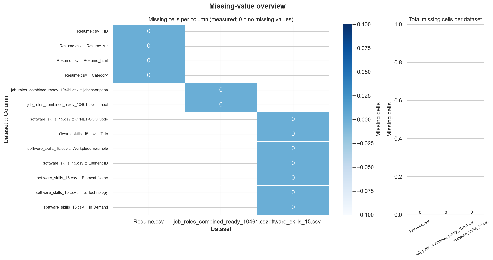
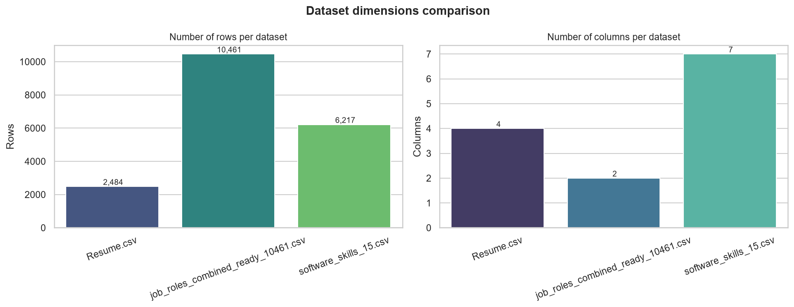
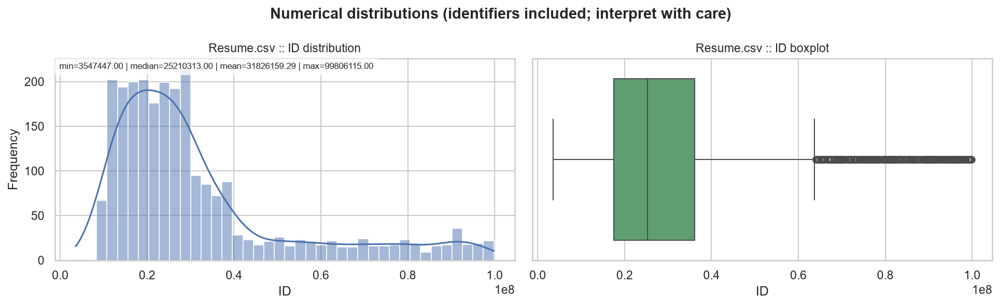
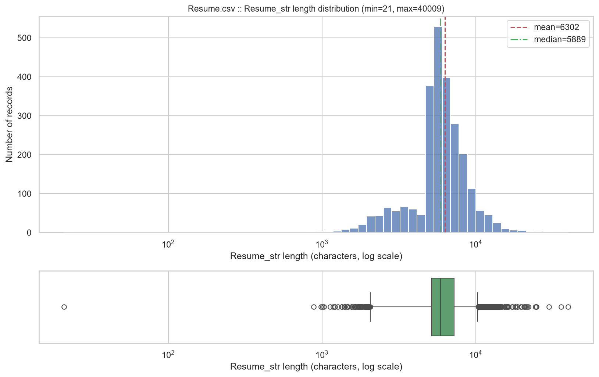
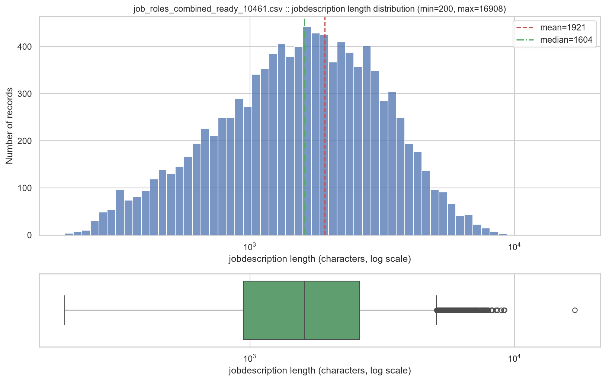
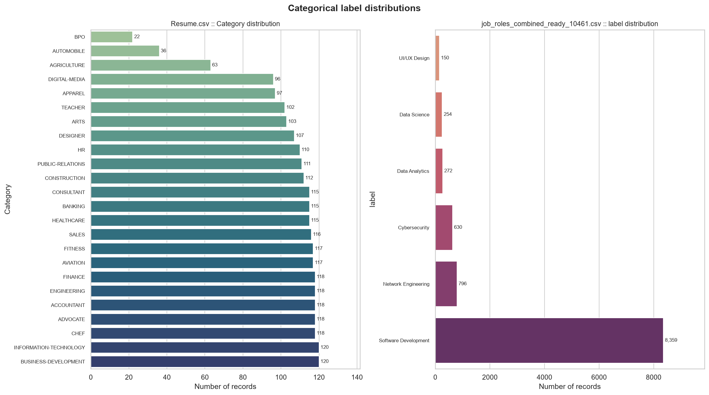
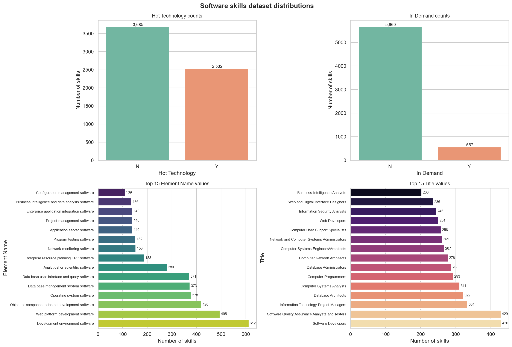

# JobMatch AI - Dataset Overview Report (Phase 2.2 EDA)

**Generated:** 2026-11-08T17:40:04+01:00

This report contains **measured results** from the three raw datasets plus clearly labelled **interpretations and assumptions**. No data cleaning, filtering, transformation, or model training was performed, and the original CSV files were not modified.

## 1. Executive summary

- **Measured:** 3 of 3 datasets were loaded successfully, containing 19,162 rows and 13 columns in total (column counts summed across datasets).
- **Measured:** 0 missing cells and 0 exact full-row duplicates were found across all three datasets.
- **Measured:** `Resume.csv` contains 2,484 résumés and 24 occupation categories. The primary text column has a median length of 5889 characters, 1 empty record(s), and 0 record(s) below the 500-character review threshold.
- **Measured:** `job_roles_combined_ready_10461.csv` is strongly imbalanced: `Software Development` accounts for 8,359 rows (79.9% of the dataset).
- **Measured:** `software_skills_15.csv` is a reference/dictionary table with 6,217 skill rows covering 36 occupation titles and 1,541 unique workplace examples; it is not a set of job postings.
- **Interpretation:** The datasets are loadable and structurally clean (no missing cells), but they require targeted cleaning and imbalance-aware modelling in later phases.

## 2. Dataset descriptions

### Resume.csv

- **Path:** `ai-engine/data/raw/resumes/Resume.csv`
- **Description:** Résumé collection with plain-text and HTML résumé versions and a single occupation/category label.
- **Source notes:** No local README was supplied for this file. Column semantics are inferred from the column names and measured values.
- **Measured dimensions:** 2,484 rows x 4 columns
- **In-memory size (deep):** 86.13 MB
- **Detected encoding:** `utf-8-sig`

### job_roles_combined_ready_10461.csv

- **Path:** `ai-engine/data/raw/job_descriptions/job_roles_combined_ready_10461.csv`
- **Description:** English IT job descriptions, each labelled with one of six role categories. Job titles were intentionally removed by the dataset authors so that models learn from description text.
- **Source notes:** Source metadata from ai-engine/data/raw/job_descriptions/README.md (PromptCloud Dice.com data, Rahman et al. Mendeley data, and O*NET-derived role mapping).
- **Measured dimensions:** 10,461 rows x 2 columns
- **In-memory size (deep):** 28.51 MB
- **Detected encoding:** `utf-8-sig`

### software_skills_15.csv

- **Path:** `ai-engine/data/raw/job_descriptions/software_skills_15.csv`
- **Description:** O*NET-derived technology/skill dictionary for SOC 15- IT occupations. Each row links an occupation to a workplace technology example and an O*NET skill category.
- **Source notes:** Source metadata from ai-engine/data/raw/job_descriptions/README.md (O*NET 30.3, CC BY 4.0; modified by the dataset authors).
- **Measured dimensions:** 6,217 rows x 7 columns
- **In-memory size (deep):** 2.64 MB
- **Detected encoding:** `utf-8-sig`

## 3. Dimensions and file integrity

| Dataset | Rows | Columns | File size | SHA-256 prefix |
| --- | --- | --- | --- | --- |
| Resume.csv | 2,484 | 4 | 53.73 MB | `d44a8f69a51b1240...` |
| job_roles_combined_ready_10461.csv | 10,461 | 2 | 19.45 MB | `2171dae4f298c86d...` |
| software_skills_15.csv | 6,217 | 7 | 666.09 KB | `d77e682526b78aa6...` |

**Measured:** the SHA-256 fingerprints recorded before and after the analysis are compared in Section 15. A match confirms that the raw files were not modified.

## 4. Column descriptions and data types

### Resume.csv

| Column | Data type | Non-null | Missing | Missing % | Unique | Description (assumed) |
| --- | --- | --- | --- | --- | --- | --- |
| ID | int64 | 2,484 | 0 | 0.00% | 2,484 | Unique résumé identifier (numeric identifier, not a feature). |
| Resume_str | str | 2,484 | 0 | 0.00% | 2,482 | Plain-text résumé content. |
| Resume_html | str | 2,484 | 0 | 0.00% | 2,482 | HTML-formatted résumé content (may contain markup). |
| Category | str | 2,484 | 0 | 0.00% | 24 | Occupation/profession label assigned to the résumé. |

### job_roles_combined_ready_10461.csv

| Column | Data type | Non-null | Missing | Missing % | Unique | Description (assumed) |
| --- | --- | --- | --- | --- | --- | --- |
| jobdescription | str | 10,461 | 0 | 0.00% | 10,461 | English IT job description text. |
| label | str | 10,461 | 0 | 0.00% | 6 | Role category label (six classes). |

### software_skills_15.csv

| Column | Data type | Non-null | Missing | Missing % | Unique | Description (assumed) |
| --- | --- | --- | --- | --- | --- | --- |
| O*NET-SOC Code | str | 6,217 | 0 | 0.00% | 36 | O*NET-SOC occupation code. |
| Title | str | 6,217 | 0 | 0.00% | 36 | O*NET occupation title. |
| Workplace Example | str | 6,217 | 0 | 0.00% | 1,541 | Example technology/software product or tool. |
| Element ID | str | 6,217 | 0 | 0.00% | 98 | O*NET element identifier for the skill category. |
| Element Name | str | 6,217 | 0 | 0.00% | 98 | O*NET skill/technology category name. |
| Hot Technology | str | 6,217 | 0 | 0.00% | 2 | O*NET hot-technology flag (Y/N). |
| In Demand | str | 6,217 | 0 | 0.00% | 2 | O*NET in-demand flag (Y/N). |

## 5. Missing-value analysis

| Dataset | Total cells | Missing cells | Missing % |
| --- | --- | --- | --- |
| Resume.csv | 9,936 | 0 | 0.00% |
| job_roles_combined_ready_10461.csv | 20,922 | 0 | 0.00% |
| software_skills_15.csv | 43,519 | 0 | 0.00% |

- **Measured:** `Resume.csv` has **0 missing cells** across 4 column(s).
- **Measured:** `job_roles_combined_ready_10461.csv` has **0 missing cells** across 2 column(s).
- **Measured:** `software_skills_15.csv` has **0 missing cells** across 7 column(s).

> **Assumption:** A whitespace-only text value is counted as present here because pandas does not treat it as `NaN`. Whitespace-only records are reported separately in the text analysis.

## 6. Duplicate analysis

| Dataset | Exact full-row duplicates | Duplicate primary text values |
| --- | --- | --- |
| Resume.csv | 0 | `Resume_str`: 2 |
| job_roles_combined_ready_10461.csv | 0 | `jobdescription`: 0 |
| software_skills_15.csv | 0 | `Workplace Example`: 4,676 |

- **Measured:** `Resume.csv` has duplicate values in `Resume_str`. Row identifiers for the duplicated group(s): 19147603, 28398216, 16850314, 37473139.
- **Measured:** `Resume.csv` has duplicate values in `Resume_html`. Row identifiers for the duplicated group(s): 19147603, 28398216, 16850314, 37473139.
- **Measured:** the 4,676 repeated `Workplace Example` values in `software_skills_15.csv` are expected because the same technology can belong to multiple occupations. This is a many-to-many mapping, not duplicated rows. The most frequent value is `Microsoft Excel` (35 rows).
- **Measured:** no exact duplicate full rows were found in any dataset.

## 7. Text analysis

Text lengths are measured in **characters**, including whitespace and any HTML markup. Empty values are whitespace-only records. The 'short' threshold is a heuristic review flag, not a data-cleaning decision.

### Resume.csv

| Column | Min | Median | Mean | Max | P01 | P99 | Empty | Short records |
| --- | --- | --- | --- | --- | --- | --- | --- | --- |
| `Resume_str` | 21 | 5889 | 6302 | 40,009 | 1641 | 15928 | 1 | 0 (< 500) |
| `Resume_html` | 1,127 | 15054 | 15730 | 61,959 | 7383 | 33030 | 0 | 0 (< 1000) |

**`Resume_str` content signals (measured):** 77.7% of records contain non-ASCII characters; 100.0% contain runs of two or more spaces; 0.3% contain HTML-like tags.

Whitespace-only record identifier(s): `12632728`.

Shortest non-empty records:

| Identifier | Label | Length | Preview |
| --- | --- | --- | --- |
| 22965804 | CONSTRUCTION | 881 | CONSTRUCTION WORKER Highlights Highly Motivated. Dependable. Ethical and honest. Dedicated. Hard working. Experience Company Name May 2014 t... |
| 21705160 | DESIGNER | 986 | GRAPHIC DESIGNER Experience Graphic Designer January 2014 to January 2015 Company Name － City , State With a personal interest in design, Ro... |
| 14381464 | SALES | 1,005 | SALES ASSOCIATE Summary My goal is to become associated with a company where i can utilize my skills and gain further experience while enhan... |
| 12696104 | SALES | 1,033 | SALES ASSOCIATE Summary Motivated sales associate with 3+ years of sales and customer service experience. Currently enrolled in Suffolk Coun... |
| 35468363 | CHEF | 1,130 | SUSHI CHEF Executive Profile 14 years experience in high end restaurants with a background in French, Japanese and Peruvian Cuisine. Experti... |

Representative records near the median length:

| Identifier | Label | Length | Preview (truncated) |
| --- | --- | --- | --- |
| 22323967 | HR | 5,594 | HR SPECIALIST, US HR OPERATIONS Summary Versatile media professional with background in Communications, Marketing, Human Resources and Technology. Experience 09/2015 to Current HR Specialist, US HR Operations Company Name － City , State Managed commu... |
| 32896934 | HR | 5,982 | HR CLERK Summary Translates business vision into HR initiatives that improve performance, profitability, growth, and employee engagement. Developing, improving and managing HR strategies in benefits and compensation, employee recruitment and developm... |

**`Resume_html` content signals (measured):** 77.7% of records contain non-ASCII characters; 99.8% contain runs of two or more spaces; 100.0% contain HTML-like tags.

Shortest non-empty records:

| Identifier | Label | Length | Preview |
| --- | --- | --- | --- |
| 12632728 | BUSINESS-DEVELOPMENT | 1,127 | 
 
 
 
 
 
 
 
 
 <div class="paragraph PARAGRAPH_NAME firstparagraph" id="PARAGRAPH_647602451_1... |

### job_roles_combined_ready_10461.csv

| Column | Min | Median | Mean | Max | P01 | P99 | Empty | Short records |
| --- | --- | --- | --- | --- | --- | --- | --- | --- |
| `jobdescription` | 200 | 1604 | 1921 | 16,908 | 291 | 6325 | 0 | 125 (< 300) |

**`jobdescription` content signals (measured):** 36.4% of records contain non-ASCII characters; 0.0% contain runs of two or more spaces; 0.0% contain HTML-like tags.

Shortest non-empty records:

| Row index | Label | Length | Preview |
| --- | --- | --- | --- |
| 7699 | Software Development | 200 | Client is looking for someone with experience in SQL programming, SSRS and SQL server. Must have over 7-8 years of total experience.Experien... |
| 1535 | Software Development | 207 | Person will modify and build tools to automate work that is completed manually today.Will perform enhancements that will improve speed to ma... |
| 1678 | Software Development | 214 | Required Skills: 10+ years of Core Java7 Years of J2EE7 Years of Spring5 Years of Tomcat5 Years of Msg Frameworks5 Years of SchemasExperienc... |
| 9977 | Software Development | 215 | Java Developer with Hadoop Location: Richmond, VA Duration: 6 months contract to hire 30% Hadoop + 70% Core Java Description: - Need Solid g... |
| 4818 | Software Development | 217 | i. .NET Framework 4.5/4.6 (using C#) ii. Strong hand-on knowledge on Windows Presentation Framework, PRISM/ MVVM / MEF Framework iii. Knowle... |

Representative records near the median length:

| Row index | Label | Length | Preview (truncated) |
| --- | --- | --- | --- |
| 2 | Software Development | 1,518 | Greetings from Computer Enterprises IncLooking for Oracle Developer in Miamisburg, OH for 12 months contract Summary: Responsible for writing programs to maintain and control computer systems software for operating systems, networked systems, and dat... |
| 8 | Software Development | 1,714 | If interested and qualified, please email resume to mkonikowski@futuresgroupit.com, or call Matt at 212-244-4220. U.S. Citizens and those authorized to work in the U.S. are encouraged to apply. We are unable to sponsor at this time.My client, a globa... |

### software_skills_15.csv

| Column | Min | Median | Mean | Max | P01 | P99 | Empty | Short records |
| --- | --- | --- | --- | --- | --- | --- | --- | --- |
| `Workplace Example` | 1 | 17 | 19 | 85 | 2 | 51 | 0 | n/a |

**`Workplace Example` content signals (measured):** 0.0% of records contain non-ASCII characters; 0.0% contain runs of two or more spaces; 0.0% contain HTML-like tags.

Shortest non-empty records:

| Row index | Length | Preview |
| --- | --- | --- |
| 49 | 1 | C |
| 125 | 1 | J |
| 230 | 1 | R |
| 357 | 1 | R |
| 418 | 1 | C |

Representative records near the median length:

| Row index | Length | Preview (truncated) |
| --- | --- | --- |
| 6 | 18 | Adobe ActionScript |
| 7 | 16 | Adobe ColdFusion |

## 8. Categorical and unique-value distributions

### Resume.csv

**`Category`** - 24 unique value(s), 24 group(s) in the value-count table.

| Value | Count | Share |
| --- | --- | --- |
| INFORMATION-TECHNOLOGY | 120 | 4.83% |
| BUSINESS-DEVELOPMENT | 120 | 4.83% |
| ADVOCATE | 118 | 4.75% |
| CHEF | 118 | 4.75% |
| FINANCE | 118 | 4.75% |
| ENGINEERING | 118 | 4.75% |
| ACCOUNTANT | 118 | 4.75% |
| FITNESS | 117 | 4.71% |
| AVIATION | 117 | 4.71% |
| SALES | 116 | 4.67% |
| HEALTHCARE | 115 | 4.63% |
| CONSULTANT | 115 | 4.63% |
| BANKING | 115 | 4.63% |
| CONSTRUCTION | 112 | 4.51% |
| PUBLIC-RELATIONS | 111 | 4.47% |
| HR | 110 | 4.43% |
| DESIGNER | 107 | 4.31% |
| ARTS | 103 | 4.15% |
| TEACHER | 102 | 4.11% |
| APPAREL | 97 | 3.90% |
| DIGITAL-MEDIA | 96 | 3.86% |
| AGRICULTURE | 63 | 2.54% |
| AUTOMOBILE | 36 | 1.45% |
| BPO | 22 | 0.89% |

### job_roles_combined_ready_10461.csv

**`label`** - 6 unique value(s), 6 group(s) in the value-count table.

| Value | Count | Share |
| --- | --- | --- |
| Software Development | 8,359 | 79.91% |
| Network Engineering | 796 | 7.61% |
| Cybersecurity | 630 | 6.02% |
| Data Analytics | 272 | 2.60% |
| Data Science | 254 | 2.43% |
| UI/UX Design | 150 | 1.43% |

### software_skills_15.csv

**`O*NET-SOC Code`** - 36 unique value(s), 36 group(s) in the value-count table.

| Value | Count | Share |
| --- | --- | --- |
| 15-1252.00 | 430 | 6.92% |
| 15-1253.00 | 429 | 6.90% |
| 15-1299.09 | 334 | 5.37% |
| 15-1243.00 | 322 | 5.18% |
| 15-1211.00 | 311 | 5.00% |
| 15-1251.00 | 293 | 4.71% |
| 15-1242.00 | 288 | 4.63% |
| 15-1241.00 | 278 | 4.47% |
| 15-1299.08 | 267 | 4.29% |
| 15-1244.00 | 261 | 4.20% |
| 15-1232.00 | 258 | 4.15% |
| 15-1254.00 | 251 | 4.04% |
| 15-1212.00 | 245 | 3.94% |
| 15-1255.00 | 236 | 3.80% |
| 15-2051.01 | 203 | 3.27% |
| 15-1221.00 | 164 | 2.64% |
| 15-1243.01 | 159 | 2.56% |
| 15-1231.00 | 142 | 2.28% |
| 15-1299.02 | 127 | 2.04% |
| 15-1299.01 | 117 | 1.88% |
| 15-2031.00 | 114 | 1.83% |
| 15-1299.03 | 106 | 1.71% |
| 15-2021.00 | 93 | 1.50% |
| 15-1299.05 | 90 | 1.45% |
| 15-2051.00 | 87 | 1.40% |
| 15-2041.00 | 70 | 1.13% |
| 15-1299.04 | 67 | 1.08% |
| 15-1299.06 | 64 | 1.03% |
| 15-1211.01 | 62 | 1.00% |
| 15-1255.01 | 57 | 0.92% |
| 15-2051.02 | 55 | 0.88% |
| 15-1241.01 | 53 | 0.85% |
| 15-1299.07 | 50 | 0.80% |
| 15-2099.01 | 47 | 0.76% |
| 15-2041.01 | 45 | 0.72% |
| 15-2011.00 | 42 | 0.68% |

**`Title`** - 36 unique value(s), 36 group(s) in the value-count table.

| Value | Count | Share |
| --- | --- | --- |
| Software Developers | 430 | 6.92% |
| Software Quality Assurance Analysts and Testers | 429 | 6.90% |
| Information Technology Project Managers | 334 | 5.37% |
| Database Architects | 322 | 5.18% |
| Computer Systems Analysts | 311 | 5.00% |
| Computer Programmers | 293 | 4.71% |
| Database Administrators | 288 | 4.63% |
| Computer Network Architects | 278 | 4.47% |
| Computer Systems Engineers/Architects | 267 | 4.29% |
| Network and Computer Systems Administrators | 261 | 4.20% |
| Computer User Support Specialists | 258 | 4.15% |
| Web Developers | 251 | 4.04% |
| Information Security Analysts | 245 | 3.94% |
| Web and Digital Interface Designers | 236 | 3.80% |
| Business Intelligence Analysts | 203 | 3.27% |
| Computer and Information Research Scientists | 164 | 2.64% |
| Data Warehousing Specialists | 159 | 2.56% |
| Computer Network Support Specialists | 142 | 2.28% |
| Geographic Information Systems Technologists and Technicians | 127 | 2.04% |
| Web Administrators | 117 | 1.88% |
| Operations Research Analysts | 114 | 1.83% |
| Document Management Specialists | 106 | 1.71% |
| Mathematicians | 93 | 1.50% |
| Information Security Engineers | 90 | 1.45% |
| Data Scientists | 87 | 1.40% |
| Statisticians | 70 | 1.13% |
| Penetration Testers | 67 | 1.08% |
| Digital Forensics Analysts | 64 | 1.03% |
| Health Informatics Specialists | 62 | 1.00% |
| Video Game Designers | 57 | 0.92% |
| Clinical Data Managers | 55 | 0.88% |
| Telecommunications Engineering Specialists | 53 | 0.85% |
| Blockchain Engineers | 50 | 0.80% |
| Bioinformatics Technicians | 47 | 0.76% |
| Biostatisticians | 45 | 0.72% |
| Actuaries | 42 | 0.68% |

**`Element ID`** - 98 unique value(s), 98 group(s) in the value-count table.

| Value | Count | Share |
| --- | --- | --- |
| 2.E.7.b | 612 | 9.84% |
| 2.E.7.h | 495 | 7.96% |
| 2.E.7.e | 420 | 6.76% |
| 2.E.13.c | 378 | 6.08% |
| 2.E.6.d | 373 | 6.00% |
| 2.E.6.f | 371 | 5.97% |
| 2.E.9.d | 280 | 4.50% |
| 2.E.2.b | 188 | 3.02% |
| 2.E.11.a | 153 | 2.46% |
| 2.E.7.f | 152 | 2.44% |

> Showing the top 10 of 98 values. The complete unique count is shown in the column profile.

**`Element Name`** - 98 unique value(s), 98 group(s) in the value-count table.

| Value | Count | Share |
| --- | --- | --- |
| Development environment software | 612 | 9.84% |
| Web platform development software | 495 | 7.96% |
| Object or component oriented development software | 420 | 6.76% |
| Operating system software | 378 | 6.08% |
| Data base management system software | 373 | 6.00% |
| Data base user interface and query software | 371 | 5.97% |
| Analytical or scientific software | 280 | 4.50% |
| Enterprise resource planning ERP software | 188 | 3.02% |
| Network monitoring software | 153 | 2.46% |
| Program testing software | 152 | 2.44% |

> Showing the top 10 of 98 values. The complete unique count is shown in the column profile.

**`Hot Technology`** - 2 unique value(s), 2 group(s) in the value-count table.

| Value | Count | Share |
| --- | --- | --- |
| N | 3,685 | 59.27% |
| Y | 2,532 | 40.73% |

**`In Demand`** - 2 unique value(s), 2 group(s) in the value-count table.

| Value | Count | Share |
| --- | --- | --- |
| N | 5,660 | 91.04% |
| Y | 557 | 8.96% |

## 9. Numerical descriptive statistics

### Resume.csv

| Column | Count | Mean | Std | Min | 25% | 50% | 75% | Max |
| --- | --- | --- | --- | --- | --- | --- | --- | --- |
| `ID` | 2484 | 31826159.29 | 21457345.62 | 3547447.00 | 17544295.50 | 25210313.00 | 36114441.00 | 99806115.00 |

> **Interpretation:** `Resume.csv::ID` is an identifier, not a meaningful numeric feature. Descriptive statistics for identifiers should not be used for modelling decisions.

## 10. Visualisations

All figures are saved in `ai-engine/data_analysis/outputs/figures/`.

### Missing-value overview

### Dataset dimensions comparison

### Numerical distributions

### Résumé text-length distribution

### Job description text-length distribution

### Category distributions

### Software skills distributions

## 11. Important observations (measured)

- `Resume.csv`: 2,484 rows x 4 columns; 0 missing cells; 0 exact full-row duplicates.
- `Resume.csv::Resume_str`: length min/median/mean/max = 21 / 5889 / 6302 / 40,009 characters; 1 empty and 0 short record(s).
- `Resume.csv::Resume_html`: length min/median/mean/max = 1,127 / 15054 / 15730 / 61,959 characters; 0 empty and 0 short record(s).
- `job_roles_combined_ready_10461.csv`: 10,461 rows x 2 columns; 0 missing cells; 0 exact full-row duplicates.
- `job_roles_combined_ready_10461.csv::jobdescription`: length min/median/mean/max = 200 / 1604 / 1921 / 16,908 characters; 0 empty and 125 short record(s).
- `software_skills_15.csv`: 6,217 rows x 7 columns; 0 missing cells; 0 exact full-row duplicates.
- `software_skills_15.csv::Workplace Example`: length min/median/mean/max = 1 / 17 / 19 / 85 characters; 0 empty and 0 short record(s).
- `Resume.csv::Category` has 24 classes; the largest is `INFORMATION-TECHNOLOGY` with 120 rows (4.8%), and the smallest is `BPO` with 22 rows (0.9%).
- `job_roles_combined_ready_10461.csv::label` has 6 classes; the largest is `Software Development` with 8,359 rows (79.9%), and the smallest is `UI/UX Design` with 150 rows (1.4%).
- `software_skills_15.csv`: 2,532 rows are flagged Hot Technology (40.7%) and 557 rows are flagged In Demand (9.0%).
- `software_skills_15.csv::Workplace Example` has 1,541 unique values across 6,217 rows; 4,676 rows repeat a previously seen workplace example because skills are mapped to multiple occupations.
- `software_skills_15.csv::Workplace Example`: 104 rows contain one- or two-character values (`C`, `C#`, `Go`, `J`, `R`). **Interpretation:** these look like valid programming-language names rather than truncated records.

## 12. Potential data-quality problems

- **Measured:** `Resume.csv::Resume_str` contains 1 whitespace-only record(s) that provide no content.
- **Measured:** 0.3% of `Resume.csv::Resume_str` records contain HTML-like tags, so plain-text extraction may be required before modelling.
- **Measured:** 77.7% of `Resume.csv::Resume_str` records contain non-ASCII characters (for example typographic hyphens), which may require normalisation.
- **Measured:** 100.0% of `Resume.csv::Resume_str` records contain runs of multiple spaces, indicating layout artefacts from PDF/HTML conversion.
- **Measured:** 100.0% of `Resume.csv::Resume_html` records contain HTML-like tags, so plain-text extraction may be required before modelling.
- **Measured:** 77.7% of `Resume.csv::Resume_html` records contain non-ASCII characters (for example typographic hyphens), which may require normalisation.
- **Measured:** 99.8% of `Resume.csv::Resume_html` records contain runs of multiple spaces, indicating layout artefacts from PDF/HTML conversion.
- **Measured:** `Resume.csv::Resume_str` has 2 duplicate value(s) beyond the first occurrence. This is an exact-match count and does not detect near-duplicates.
- **Measured:** `Resume.csv::Resume_html` has 2 duplicate value(s) beyond the first occurrence. This is an exact-match count and does not detect near-duplicates.
- **Measured:** `job_roles_combined_ready_10461.csv::jobdescription` contains 125 non-empty record(s) shorter than 300 characters; these may be truncated or low-information records.
- **Measured:** 36.4% of `job_roles_combined_ready_10461.csv::jobdescription` records contain non-ASCII characters (for example typographic hyphens), which may require normalisation.
- **Measured:** `software_skills_15.csv::Workplace Example` has 4,676 duplicate value(s) beyond the first occurrence. This is an exact-match count and does not detect near-duplicates.
- **Measured:** the job-role label distribution is highly imbalanced (largest class is 55.7x the smallest class).
- **Interpretation:** without stratification or class weighting, a classifier may over-predict the dominant role.
- **Interpretation:** `Resume.csv` covers 24 broad occupation categories, many outside IT (for example CHEF, AVIATION, FITNESS). Using all categories unchanged may add noise for an IT-focused job matcher.
- **Interpretation:** `Resume_html` is an HTML representation of the same résumés and should probably be treated as an alternative source rather than an independent feature, to avoid duplication.
- **Interpretation:** `software_skills_15.csv` is a skill dictionary, not a job-posting corpus; it can support skill normalisation and enrichment but cannot train a job-role classifier by itself.

## 13. Assumptions and limitations

- **Assumption:** `utf-8-sig` is the correct encoding; fallback encodings were only attempted on decode failure. The detected encoding for each dataset is reported in Section 2.
- **Assumption:** text length is measured in characters, including whitespace and HTML markup for `Resume_html`.
- **Assumption:** the 'short record' thresholds (`Resume_str` < 500, `Resume_html` < 1000, `jobdescription` < 300 characters) are heuristic review flags, not data-cleaning rules. No short threshold is applied to `Workplace Example` because one- and two-character technology names such as C, R, and J are valid.
- **Assumption:** duplicate detection uses exact string equality only; near-duplicates, whitespace-normalised duplicates, and semantic duplicates were not measured.
- **Assumption:** column descriptions are inferred from column names and dataset documentation because no formal data dictionary exists for `Resume.csv`.
- **Limitation:** this phase does not clean, normalise, deduplicate, or filter records, and does not evaluate text content quality semantically.
- **Limitation:** the software skills table has no numeric columns; its Y/N flags were analysed as categorical values.

## 14. Recommendations for the next phase

1. **Handle the empty résumé:** inspect `Resume.csv` ID `12632728` and decide whether to repair, replace, or remove it during documented cleaning.
2. **Resolve duplicates:** review the two duplicate `Resume_str` groups (IDs `19147603`/`28398216` and `16850314`/`37473139`) and document a dedupe policy. Also check near-duplicates after whitespace normalisation.
3. **Normalise text:** remove/skip HTML markup for `Resume_html`, collapse repeated whitespace, normalise typographic characters, and preserve a cleaned plain-text field for modelling.
4. **Define the résumé scope:** decide whether to keep all 24 résumé categories or map/filter them to the six IT role classes used by the job dataset. Document the mapping before training.
5. **Address class imbalance:** use stratified splits, class weights, and imbalance-aware metrics (macro-F1, per-class recall) for the job-role classifier.
6. **Validate the skills dictionary:** confirm that `Workplace Example` values are suitable for skill extraction, and decide how to aggregate duplicate technologies across occupations and O*NET elements.
7. **Keep provenance:** record cleaning rules, dropped/edited row identifiers, and file hashes so that later phases remain reproducible.
8. **Proceed only after review:** do not start feature engineering or modelling until the cleaning decisions above are approved.

## 15. Validation

- **Python:** `3.12.8`
- **pandas:** `3.1.1`
- **numpy:** `2.5.4`
- **matplotlib:** `3.11.2`
- **seaborn:** `0.13.2`
- **Script:** `ai-engine/data_analysis/01_dataset_overview.py`
- **Working directory at run time:** `C:\Users\nourm\CV_Analysis`

| Dataset | Size before | Size after | SHA-256 prefix | Unchanged |
| --- | --- | --- | --- | --- |
| Resume.csv | 53.73 MB | 53.73 MB | `d44a8f69a51b1240...` | YES |
| job_roles_combined_ready_10461.csv | 19.45 MB | 19.45 MB | `2171dae4f298c86d...` | YES |
| software_skills_15.csv | 666.09 KB | 666.09 KB | `d77e682526b78aa6...` | YES |

- **Measured:** dataset integrity check PASSED - all raw files are unchanged.
- **Measured:** 3 dataset(s) loaded and profiled.
- **Measured:** 7 figure(s) generated.
- **Measured:** no errors were encountered during the run.

---

*This report was generated automatically by `ai-engine/data_analysis/01_dataset_overview.py`. Measured values are reproducible by re-running the script; assumptions and interpretations are labelled explicitly.*
